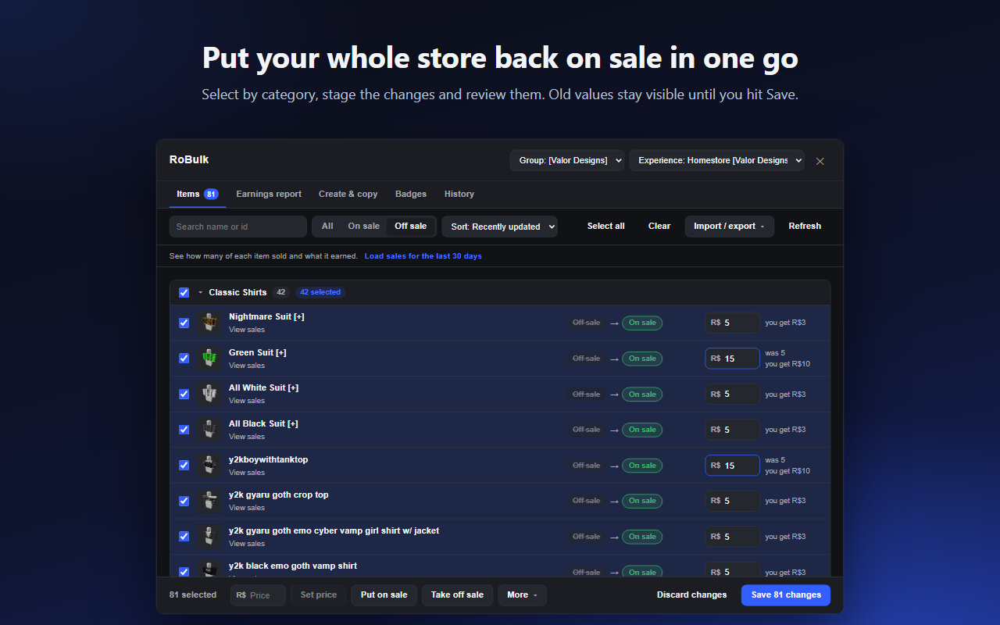
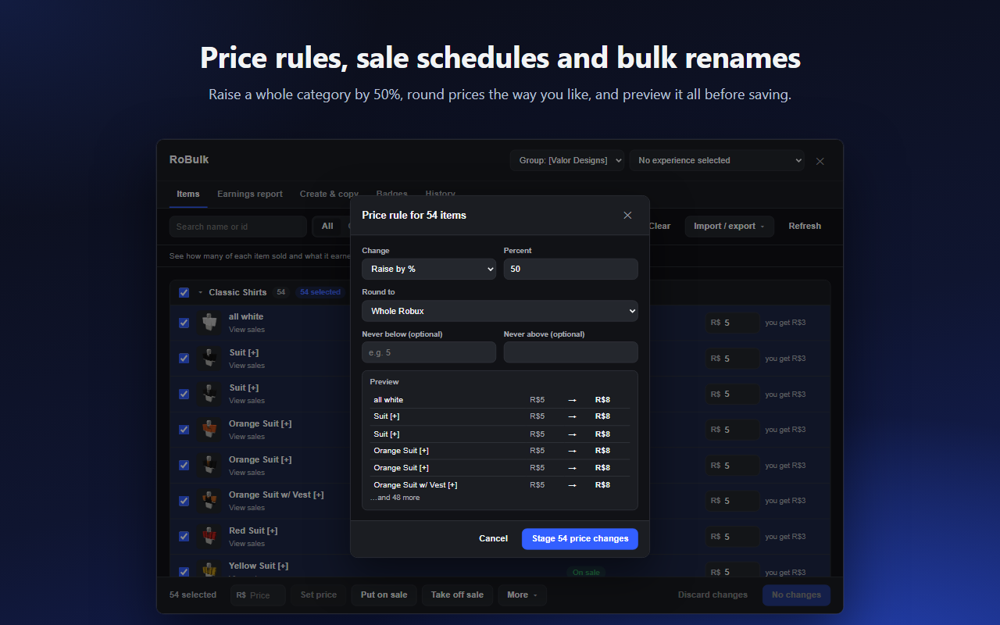
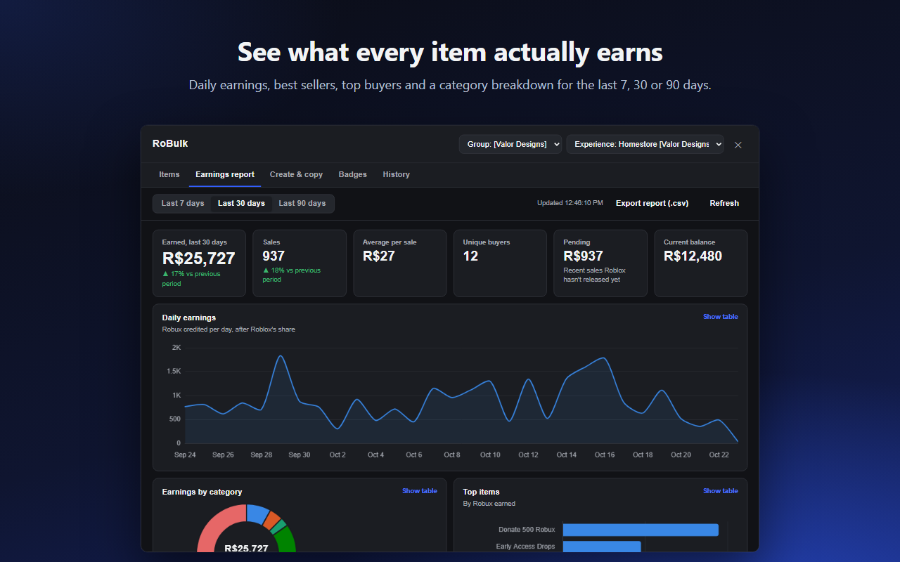
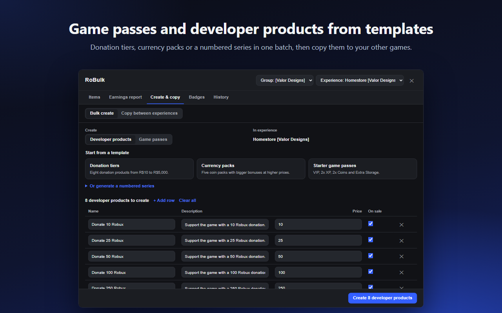
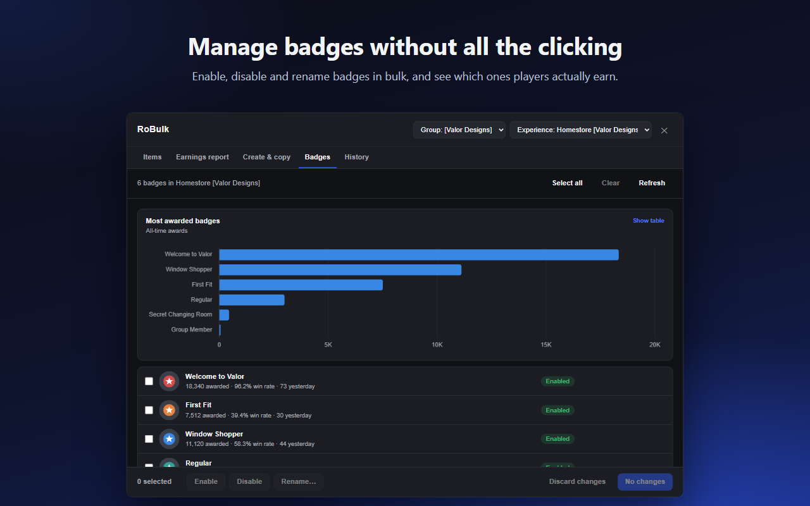

# RoBulk

Bulk tools for the Roblox Creator Dashboard. Price, rename, schedule and put items on or off sale by the dozen instead of one at a time, see what your store and games actually earn, and spin up game passes and developer products from templates.

Works for clothing and UGC sellers and for game developers, on items owned by you or by your groups.



- [What it does](#what-it-does)
- [How to use](#how-to-use)
- [Tips and troubleshooting](#tips-and-troubleshooting)
- [Development](#development)

## What it does

**Items**
- Every avatar item you own (classic shirts, pants and t-shirts, accessories, layered clothing, heads) plus the game passes and developer products of whichever experience you pick, grouped by category
- Checkboxes, *Select all* per category, shift-click ranges, search, on/off-sale filter, sorting by price or best sellers
- Bulk actions: set price, put on sale, take off sale, price rules (raise or lower by % or Robux, round to prices ending in 9 or 99, min/max), scheduled sales, rename and description templates, regional pricing and managed pricing on/off
- Shows what you keep from each sale at the current price
- Every change is staged first, with old → new values on each row, and only sent when you hit Save
- Saves go out one item at a time with pacing, retry on rate limits, and per-row results so failures can be fixed and retried
- Spreadsheet export/import (.csv) and a Lua export of pass/product ids ready to drop into a ModuleScript

**Earnings report**
- Earned, sales, average per sale, unique buyers, pending Robux and current balance, compared with the previous period
- Daily earnings, earnings by category, top items, sales per day and top buyers, for the last 7, 30 or 90 days or all time
- Per-item sales and earnings from the Items tab
- Sales load in the background when RoBulk opens, with a progress bar at the bottom of the panel and under RoBulk in the dashboard's sidebar
- A count of new sales since you last opened the report, on the sidebar entry and at the top of the report
- Every chart has a table view, and the report exports to .csv

**Account Overview**
- Earnings, sales, pending Robux and balance for your account and every group you can see the revenue of, side by side, with totals

**Payouts** (groups)
- Works out what each designer is owed: their share of what their items earned, since their last payout or for a month you pick
- Exports to .csv and links to Roblox's payouts page. RoBulk never sends Robux itself

**Off-sale alarm**
- If items RoBulk has seen on sale are taken off sale without you doing it (for example when a group owner's Premium runs out), a banner shows on roblox.com and on the Creator Dashboard until you close it, with a one-click way to put them back on sale

**Create & copy**
- Bulk-create developer products or game passes from templates (donation tiers, currency packs, starter passes) or a numbered series, with one icon for all of them
- Copy passes and products from one experience to another, icons included

**Badges**
- Enable, disable and rename badges in bulk, with award counts and win rates

**History**
- A snapshot of your prices and sale status is taken automatically once a day and before every save, so you can put everything back the way it was (handy when a lapsed Premium subscription takes a group's clothing off sale)
- Activity log of everything saved through RoBulk, exportable to .csv

**Options**
- Switch off background sales loading, saved sales, the per-sale earnings lookup, daily snapshots, the off-sale alarm or the new-sales count
- Choose how many sales to keep per account or group (100,000 by default, up to no limit)
- Experimental: a "Best times to sell" chart, and a price vs. sales comparison for each item

## How to use

### 1. Open RoBulk

1. Sign in to Roblox and go to the [Creator Dashboard](https://create.roblox.com/dashboard/creations).
2. Click **RoBulk** in the dashboard's left sidebar, just below **All tools**. (**Account Overview**, just below it, opens the side-by-side view of all your groups.) If the sidebar is hidden (in a narrow window, for example), a blue **RoBulk** button appears in the bottom-right corner instead. If you don't see either, refresh the page.
3. Use the two menus at the top right:
   - **Creator:** yourself, or one of your groups. Only groups where your role is allowed to manage items or experiences are listed. RoBulk opens on whichever group you have selected in the Creator Dashboard (or on you, if you're viewing your own creations).
   - **Experience:** starts on *No experience selected*. Pick a game to also show its passes and developer products, and to use the Create & copy and Badges tabs. Your avatar items show either way.

Press **Esc** or click **✕** to close. If you have unsaved changes, RoBulk asks first.

### 2. The golden rule: nothing changes until you click Save

Every action in the Items tab only *stages* a change. Changed rows are highlighted and show the old value next to the new one (for example `Off sale → On sale`, or `was 5` under a new price). The Items tab shows how many changes are waiting.

- **Save N changes** sends them to Roblox, one item at a time.
- **Discard changes** throws them all away.
- While saving, each row gets a ✓ or a red message explaining what Roblox said. Failed rows stay staged so you can fix them and click Save again. **Stop** cancels the rest.

Before every save RoBulk records the old values, so any save can be undone from the [History tab](#8-undo-a-save-or-restore-your-store-history).

### 3. Put a lot of items on (or off) sale

This is the "my whole store went off sale" fix.

1. In the **Items** tab, click **Off sale** in the filter.
2. Tick the checkbox next to a category name (for example **Classic Shirts**) to select every item in it, or click **Select all** to select everything shown. You can also tick rows one by one, and shift-click to select a range.
3. Click **Put on sale** at the bottom.
4. Look over the highlighted rows, then click **Save N changes**.

**Take off sale** works the same way. The filter goes by each item's saved status, so staged items stay in view until you save.

### 4. Change prices

- **One item:** type in the row's price box and press Enter.
- **Many items at the same price:** select them, type the price in the box at the bottom, and click **Set price**.
- **Raise or lower by a rule:** select items, then **More → Price rule**. Pick a change (set to, raise or lower by % or Robux), how to round (whole Robux, ending in 9, ending in 99, multiples of 5 or 10), and an optional floor and ceiling. The preview shows old → new prices before you stage anything. Raises always round up and discounts always round down, so a raise never lowers a price.

Under each price, *you get R$X* shows what you keep from one marketplace sale at that price, as Roblox calculates it. Roblox's share is progressive: at the minimum price you keep 30%, and the further your price is above the minimum, the more you keep, up to 70%. Change a price and the estimate updates. (Sales made inside an experience pay the base 30%.)



### 5. Schedule a sale, rename, and other bulk actions

All of these are in the **More** menu at the bottom of the Items tab and apply to the selected items:

- **Schedule a sale:** pick when items go on sale and, optionally, when they come off. Roblox handles the timing, so your computer doesn't need to be on. Avatar items only (Roblox doesn't support schedules for passes and products). *Remove existing schedule* clears one.
- **Rename:** add a prefix (like `[VD] `), add a suffix, find and replace, or use a template. Templates understand `{name}` (current name), `{n}` (1, 2, 3… in selection order), `{price}` and `{id}`. For example, `{name} #{n}` turns three items into "Suit #1", "Suit #2", "Suit #3".
- **Edit descriptions:** the same options. In templates, `{current}` stands for the existing description, so a template of `{current}`, a blank line, then `More at our group!` adds that line to the end of every description.
- **Turn regional pricing on/off.**
- **Turn managed pricing on/off:** game passes and developer products only. You can also click the *Managed pricing* chip on a single row.
- **Take a snapshot now:** saves the current state to History without changing anything.

### 6. Work in a spreadsheet

1. **Import / export → Export all items (.csv)** (or *Export selected*).
2. Open the file in Excel or Google Sheets and edit the `price`, `on_sale` (yes/no), `name` or `description` columns. Leave `type` and `id` alone; that's how rows are matched back up.
3. **Import / export → Import spreadsheet (.csv)** and pick the file. Changed cells are staged in the Items tab and a summary lists anything that couldn't be read. Review, then **Save**.

### 7. See what you're earning



Open the **Earnings report** tab. It loads your sales for the period you choose (**Last 7 / 30 / 90 days** or **All time**) and shows:

- earned, number of sales, average per sale, unique buyers, pending Robux and your current balance, with the change from the previous period
- daily earnings, earnings by category, your top items, sales per day and your top buyers

Every chart has **Show table** for the exact numbers, and **Export report (.csv)** saves the daily totals and top items. For groups, you need permission to view the group's revenue.

**All time** adds up every sale since your first one, with weekly charts once your history is longer than 90 days. The first time, RoBulk has to read your whole sales history from Roblox, which can take a while for a busy store. The report fills in as sales arrive, and every page of sales is saved in your browser the moment it's loaded, so nothing is lost if you click **Stop**, close RoBulk, switch creators or leave the page: next time it carries on from where it got to. Clicking **All time** again while it loads doesn't start over, and closing RoBulk doesn't stop it. After that, RoBulk only fetches new sales.

RoBulk starts loading sales in the background as soon as you open it, so the report is usually ready by the time you click the tab. While it loads, a bar at the bottom of the panel shows progress and has a **Stop** button. You can turn background loading off in the **Options** tab.

Sales are loaded once per visit to the dashboard: switching ranges, closing and reopening RoBulk, or switching creators and back all reuse what's already loaded without asking Roblox again. Click **Refresh** whenever you want the latest sales.

For a single item, click **View sales** under its name in the Items tab (once sales are loaded it reads *12 sold · R$84*). The Items tab's **Sort** menu then also offers *Best sellers* and *Most earned*.

### 8. Undo a save or restore your store (History)

The **History** tab has two views:

- **Snapshots & undo.** RoBulk takes a snapshot of your prices and sale status once a day when you open it, and right before every save. Click **Restore** on any snapshot to stage those old values in the Items tab, then review and **Save**. If a group's clothing is ever pushed off sale (for example when the owner's Premium lapses), restore the last snapshot from before it happened.
- **Activity log.** Every change saved through RoBulk, with old and new values and whether it worked. Tick *Failures only* to find problems, or export it to .csv.

Snapshots and the log live in your browser only.

### 9. Create game passes and developer products in bulk



1. Pick the experience at the top, then open **Create & copy → Bulk create**.
2. Choose **Developer products** or **Game passes**.
3. Click a template (*Donation tiers*, *Currency packs*, *Starter game passes*), or open **Or generate a numbered series** to make things like "Crate 1…10" with stepped prices. Use **+ Add row** for one-offs.
4. Edit any name, description, price or on-sale box in the table, and optionally choose one icon for all of them.
5. Click **Create N developer products**. Each row shows ✓ when it's created.

Roblox allows at most 50 game passes on sale per experience.

### 10. Copy passes and products to another game

1. **Create & copy → Copy between experiences.**
2. Pick **Copy from** and **Copy to**, tick the items, and choose whether to copy icons and whether the copies should start off sale.
3. Click **Copy**.

### 11. Use your ids in scripts

With an experience selected, **Import / export → Export pass & product ids as Lua** gives you a ready-made table:

```lua
return {
	GamePasses = {
		VIP = 123456789, -- VIP
	},
	DeveloperProducts = {
		Donate100Robux = 987654321, -- Donate 100 Robux
	},
}
```

Copy it into a ModuleScript (for example `ReplicatedStorage.MonetizationIds`) and require it from your scripts. Tick *Include prices* to get `{ Id = …, Price = … }` entries instead.

### 12. Manage badges



Open the **Badges** tab with an experience selected. The chart shows your most-awarded badges, and each row shows awards, win rate and awards yesterday. Select badges and use **Enable**, **Disable** or **Rename…** (or click a badge's *Enabled/Disabled* pill to toggle it), then **Save**.

### 13. Pay your designers (Payouts)

Open the **Payouts** tab with a group selected. Add each designer by Roblox username, set their share, and click **Choose items** to pick the items they made (search for a tag like `[+]` and click **Select all shown**). RoBulk adds up what those items earned the group and works out each payout, since their last payout by default, or for this month, last month or the last 30 days.

Pay them on Roblox's payouts page (**Open Roblox payouts**), then click **Mark as paid** so their next period starts from there. RoBulk never sends Robux itself.

### 14. See all your groups at once (Account Overview)

Click **Account Overview** in the dashboard's sidebar (or the button at the top of RoBulk). It loads each account and group's sales one at a time and shows earnings, change from the previous period, sales, pending Robux and balance side by side, with totals. **Open report** jumps to that group's Earnings report.

### 15. Get warned when items go off sale

RoBulk remembers which items were on sale whenever it loads them. When you visit roblox.com or the Creator Dashboard, it checks again (at most every 10 minutes), and if any were taken off sale without RoBulk doing it, a banner says so on each site. It stays until you click its ✕, separately on each site. On the dashboard, **Put back on sale…** opens RoBulk with those items staged on sale, ready to review and save.

### 16. Change what RoBulk does on its own (Options)

The **Options** tab lets you switch off things RoBulk does on its own: loading sales in the background, remembering sales between visits (turning it off deletes them, and it shows how much space they take), looking up what you get per sale, the daily snapshot, the off-sale alarm and the new-sales count. Settings are saved in your browser and apply to every creator.

You can also choose how many sales to keep per account or group: 100,000 by default (about 6 MB), up to no limit. Above 500,000, RoBulk warns that it can take a lot of space. Sales are saved in the extension's storage; if the browser won't take that many, RoBulk keeps them in a database of its own instead.

Under **Experimental**:
- **Best times to sell** adds a day-by-hour chart of when your sales come in to the Earnings report.
- **Price vs. sales** compares how an item sold before and after its last price change, in the item's sales view. It uses RoBulk's snapshots and change log, so it only knows about changes from when RoBulk was installed.

## Tips and troubleshooting

- **RoBulk isn't in the sidebar.** Refresh the dashboard tab, especially right after installing or updating RoBulk.
- **A group is missing from the creator menu.** Your role in that group needs permission to manage the group's items or experiences. Ask the group owner.
- **A row shows a red message after saving.** That's Roblox's own reason, for example a price below the minimum, a missing permission, or a group that lost its owner's Premium. Fix it and save again; only the failed rows are sent.
- **"Limited items aren't supported yet."** Limiteds have extra settings (stock, resale) that RoBulk doesn't touch, so they're skipped. Edit them on the dashboard.
- **An item never put on sale is missing.** RoBulk lists avatar items from Roblox's catalog, which only has published items. Classic clothing that was uploaded but never published is listed in a warning at the top of the Items tab instead: Roblox charges a R$10 publishing fee for each one, and RoBulk never spends Robux for you, so publish them on the dashboard first.
- **Prices look out of date right after a save.** Roblox's catalog takes a little while to catch up. RoBulk shows your saved values right away; a later Refresh may briefly show the old ones.
- **All time is slow the first time.** Roblox only hands out sales history a page at a time, newest first, so a store with years of sales takes a few minutes to load once. Later loads only fetch what's new.

## Development

```sh
npm run dev           # rebuild dist/ on every change
npm test              # unit and UI tests
npm run preview       # the panel on sample data: open dist-preview/index.html
npm run package       # store zips in release/ for Chrome and Firefox
npm run store-assets  # re-render the store screenshots and promo images
npm run icons         # regenerate public/icons
```

`npm run preview` is the quickest way to work on the UI without touching a real account. Add `?tab=earnings` (or `create`, `badges`, `history`) and `&theme=light` to the URL.

### How saving works

Roblox has no bulk endpoint, so RoBulk sends one request per item through your existing dashboard session.

- **Avatar items** are listed with the public catalog search. Before saving, RoBulk reads the item's full sale settings (`GET itemconfiguration.roblox.com/v1/items`) and sends them back unchanged apart from what you edited (`PATCH /v1/collectibles/{collectibleItemId}`), because that endpoint replaces every setting at once. Renames use `/v1/collectibles/update-item-display-information`. Limited items are skipped.
- **Game passes and developer products** use Roblox's documented [game pass](https://create.roblox.com/docs/cloud/reference/features/game-passes) and [developer product](https://create.roblox.com/docs/cloud/reference/features/developer-products) endpoints, sending only the fields that changed.
- **Badges** use `PATCH badges.roblox.com/v1/badges/{id}`.
- **Earnings** come from your sale transactions (`economy.roblox.com/v2/{users|groups}/{id}/transactions`), cached in `chrome.storage.local`. Each load fetches only sales newer than the last load, going back further only as far as the oldest sale still marked pending (at most 35 days), plus anything older that isn't cached yet. RoBulk keeps Roblox's page cursor from where each load stopped, so going further back resumes from there; if Roblox no longer accepts an old cursor, it pages from the newest sale instead. Pages are fetched back to back, and slow down only after Roblox says to.

## Privacy

RoBulk has no servers, analytics or accounts. It only talks to Roblox, using the login you already have, and keeps snapshots, the activity log and your saved sales in your browser's extension storage. See [PRIVACY.md](PRIVACY.md).

## License

[MIT](LICENSE) © 2026 mibbinator. Use it, change it, ship it, just keep the copyright notice and license with any copy.

## Disclaimer

RoBulk is not affiliated with, endorsed by, or sponsored by Roblox Corporation.
